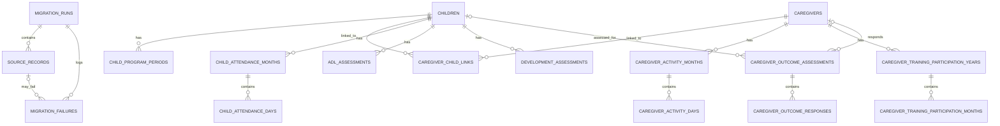

# Phase 1 Data Model / ERD

Project: Kickstarter Tamahar  
Supabase target: `pre-kc2-pilot-Vidhan`

## Tables

### public
- children
- child_program_periods
- caregivers
- caregiver_child_links
- child_attendance_months
- child_attendance_days
- caregiver_activity_months
- caregiver_activity_days
- caregiver_training_events
- caregiver_training_participation_years
- caregiver_training_participation_months
- adl_assessments
- development_assessments
- caregiver_outcome_assessments
- caregiver_outcome_responses

### private
- migration_runs
- source_records
- migration_failures

## Design decisions
- Internal UUID primary keys are used while original source IDs remain preserved.
- Programme and centre values remain source text because the source does not provide authoritative master tables.
- Daily attendance is normalized from day-number columns into child/caregiver day rows.
- Caregiver outcome question responses are normalized into response rows.
- Source-derived totals and QA fields are retained where modeled.
- Source lineage is mandatory for migrated business records.
- Business values remain text rather than PostgreSQL enums where source semantics are not authoritative.
- Hidden legacy attendance sources are retained for lineage/failure reporting rather than automatically merged into current attendance.
